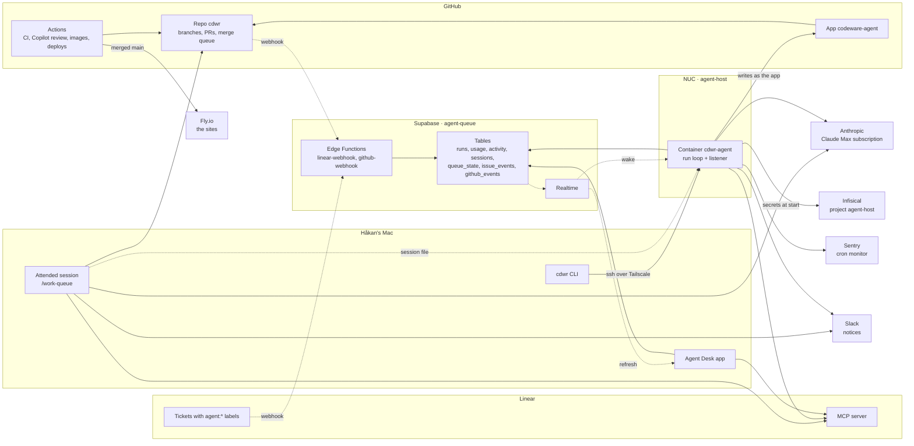
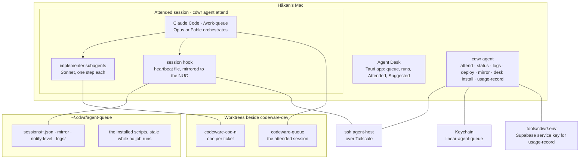
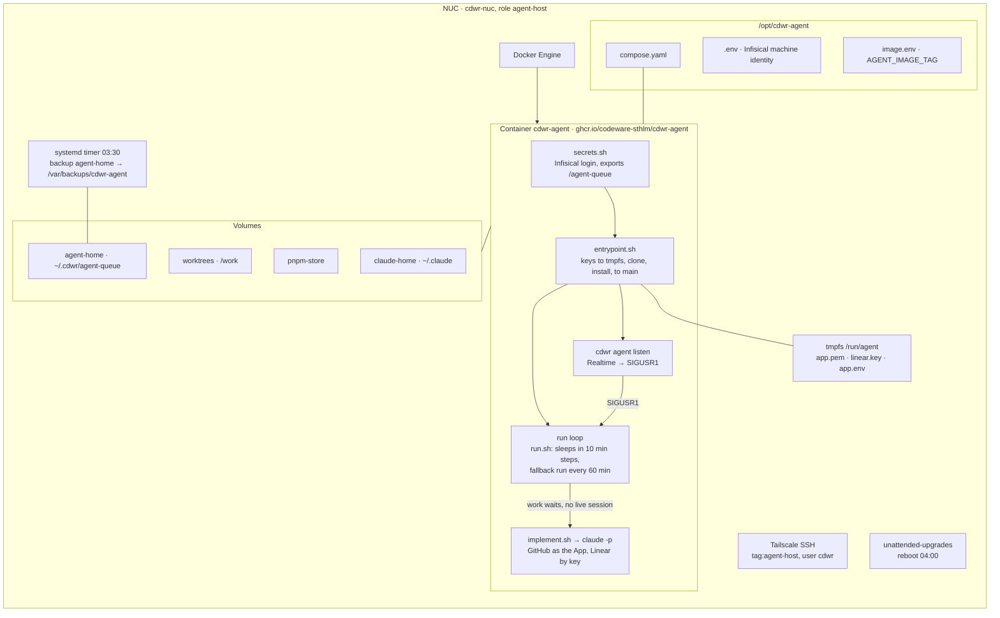
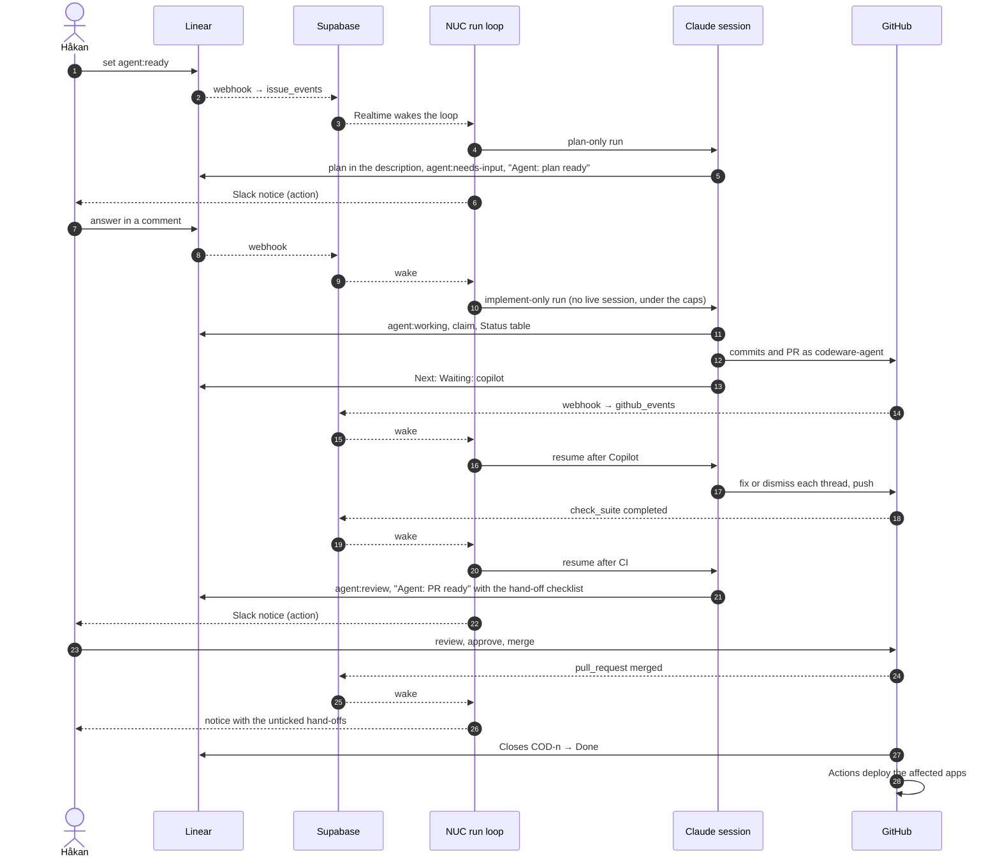
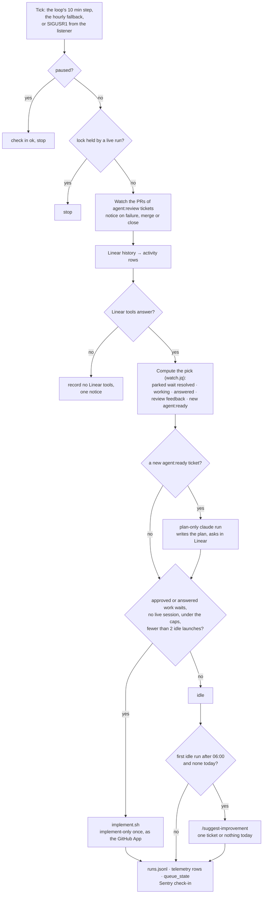
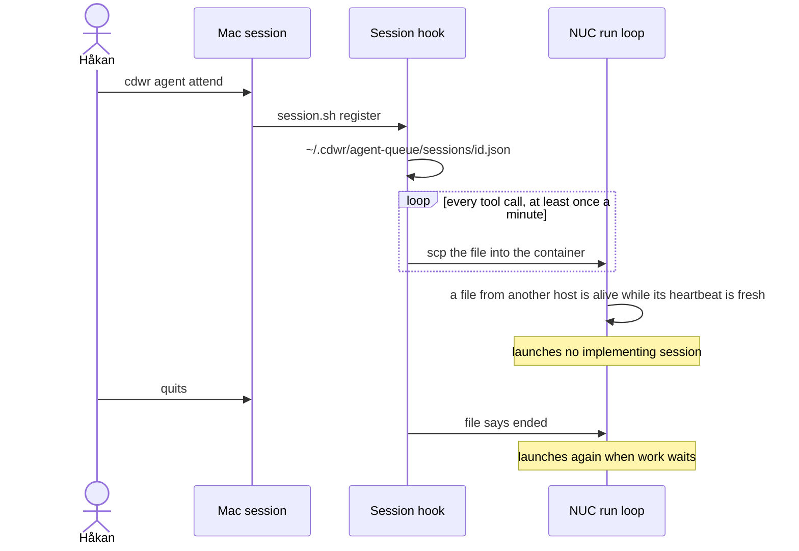

# The agent queue, mapped

Two shores and the cloud between them. Green arrows are work moving: tickets, answers, code.
Grey arrows are signals: events and notices. Everything below is the detail behind that picture:
every machine, service and file that takes part in working a Linear ticket without a person at
the keyboard, in four views small enough to read on their own. The details behind every box are
in the [cdwr README](../README.md) (the agent queue, the NUC) and the
[work-queue skill](../../../.claude/skills/work-queue/SKILL.md).

The drawing is `map.svg` beside this file, in the site's colour tokens with fallbacks for GitHub,
and it passes the site's SVG sanitiser unchanged, so a cdwr.io page can place it as an
illustration.

The NUC runs the schedule: its container plans, launches implementing sessions and watches the
PRs. The Mac is where attended work happens, where the Desk shows the queue and where the CLI
installs and inspects the rest. The same scripts can run as a launchd job on the Mac
(`cdwr agent install`); that job is not installed today, so the NUC is the only scheduler. Linear
is the only source of truth for what a ticket is waiting on. Everything else is a cache, a log or
a key.

## 1. Landscape

Who talks to whom. Solid arrows are calls the queue makes; dashed arrows are events pushed to it.
The attended session reaches GitHub as Håkan; the container only ever as the App.

## 2. What runs where

### The Mac

The attended session, the Desk and the CLI. No scheduler runs here today.

- **Attended session.** `cdwr agent attend [COD-n]` moves `codeware-queue` to `origin/main` and
  starts `/work-queue` there. Linear through the claude.ai connector, GitHub as Håkan. Its
  heartbeat file tells both schedulers a session is alive.
- **The scheduler, if wanted here.** `cdwr agent install` sets up a launchd job running the
  same `run.sh` every 10 minutes from a `codeware-agent` worktree, with the Linear key in the
  Keychain. It is not installed: `cdwr agent status` says `job: not loaded`, and the local queue
  home is paused. A pause is per host, so it holds nothing on the NUC.
- **Agent Desk.** Reads the Supabase tables with the publishable key and Linear with its own
  key; refetches an issue when Realtime says it changed. Installed from CI with
  `cdwr agent desk install`.

### The NUC

One Ubuntu box, one container, reached only over the tailnet.

- **Secrets.** The NUC holds only the Infisical identity. The container reads production
  `/agent-queue` at start: the GitHub App, the Linear key, the Claude OAuth token, the Supabase
  keys, the Sentry DSN and the Slack webhook. A rotation takes a `docker compose restart`.
- **Each run.** Watch the PRs of `agent:review` tickets, send the activity rows, plan one
  `agent:ready` ticket if any (read-only tools, Linear the only writable server), then launch an
  implementing session when approved or answered work waits and no session is alive. Per-run
  budget and a daily cap in `implement-spend.jsonl`. The decision tree is in **Flows**.
- **Waking.** The listener subscribes to `issue_events` and `github_events` and signals the
  loop 15 s after the first event, at most once a minute. The loop still decides: pause, lock,
  live-session check and spend caps apply. Without the listener it polls every 10 minutes.
- **Updating.** `cdwr agent deploy --host agent-host` from the Mac: pause, wait for the running
  job, write the tag, pull, restart, resume. The listener runs from the checkout, so it follows
  main at the next start.

## 3. Flows

### A ticket, from label to merge

In an attended session on the Mac the same steps run in one go, with the gates answered in
Linear while the session moves on to the next ticket. The NUC sees that session through its
mirrored heartbeat file and starts nothing beside it.

### What one run decides

### Why the NUC stays quiet while you work

## 4. Hands

What only a person does, and where.

| Action                                        | Where                                                        | Effect                                                                                              |
| --------------------------------------------- | ------------------------------------------------------------ | --------------------------------------------------------------------------------------------------- |
| Set `agent:ready` on a ticket                 | Linear                                                       | The ticket enters the queue; a sub-issue stays off until set                                        |
| Answer an `**Agent: plan ready**` or question | Linear comment                                               | The ticket resumes at the next run or session                                                       |
| Review and merge the PR                       | GitHub                                                       | Linear closes the ticket; the merge notice lists hand-offs                                          |
| Tick a hand-off item                          | The `**Agent: PR ready**` comment                            | The Desk and the merge notice stop counting it                                                      |
| Accept or discard a daily suggestion          | Linear: `agent:ready`, or cancel with one word               | Queued, or recorded as taste for later runs                                                         |
| Start attended work                           | `cdwr agent attend [COD-n]`                                  | `codeware-queue` to main, `/work-queue` in the terminal                                             |
| Hold or release the schedule                  | `cdwr agent pause` / `resume`, inside the container over ssh | Per host: the loop still ticks and checks in, starts nothing; `deploy` pauses and resumes by itself |
| Run the scheduler on the Mac as well          | `cdwr agent install`                                         | A launchd job every 10 minutes; not installed today                                                 |
| Update the NUC                                | `cdwr agent deploy --host agent-host`                        | New image tag, restart, listener to main                                                            |
| Mirror the Mac's sessions                     | `cdwr agent mirror set --host agent-host`, once              | The NUC sees attended sessions                                                                      |
| See the state                                 | `cdwr agent status [--host agent-host]`, Agent Desk          | Queue view, Attended, Suggested, listener, watched PRs                                              |
| Read a log                                    | `cdwr agent logs [--run] [--host …]`                         | Scheduler log or the latest run, local or over ssh                                                  |
| Rotate a secret                               | Infisical `/agent-queue`, then `docker compose restart`      | The container re-reads at start                                                                     |
| Deploy a webhook function                     | `supabase functions deploy …`                                | Linear or GitHub events reach the tables again                                                      |
| Install the Desk                              | `cdwr agent desk install`                                    | Newest CI build into /Applications                                                                  |

## Where state lives

| State                               | Lives in                                                           | Read by                                                  |
| ----------------------------------- | ------------------------------------------------------------------ | -------------------------------------------------------- |
| What a ticket waits on, plan, claim | The Linear ticket: labels, description, comments                   | Every session and run                                    |
| Whether a session is alive          | `~/.cdwr/agent-queue/sessions/*.json`, mirrored                    | Both run loops                                           |
| What the PR watch last sent         | `~/.cdwr/agent-queue/watch.json`                                   | run.sh, `cdwr agent status`                              |
| Spend of launched sessions          | `~/.cdwr/agent-queue/implement-spend.jsonl`                        | run.sh caps                                              |
| Run history, queue view, Attended   | Supabase `runs`, `queue_state`; `runs.jsonl` locally               | Agent Desk, status, suggest                              |
| Listener health                     | `listener.json` in the queue home                                  | The loop's sleep, status                                 |
| Linear key                          | Keychain `linear-agent-queue`; tmpfs `/run/agent`                  | lib.sh header helper                                     |
| GitHub App key                      | A `.pem` outside every checkout; tmpfs in the container            | github-app.sh                                            |
| Container secrets                   | Infisical project `agent-host`, folder `/agent-queue`              | secrets.sh at start                                      |
| The scripts that run unattended     | `/opt/agent-queue` in the image, copied to the queue home at start | Replaced by `deploy`; `install` does the same on the Mac |
